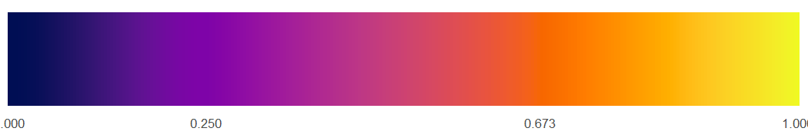

# viridis-SYR


An R package with one continuous colour scale in the [viridis](https://sjmgarnier.github.io/viridis/) family,
anchored to Syracuse University colours. **viridis-SYR** starts at Syracuse navy (`#000E54`), passes through the
viridis *plasma* purple (`#7E03A8`) and Syracuse orange (`#F76700`), and ends at the plasma yellow (`#F0F921`).
The R package is `viridisSYR`.



Not affiliated with or endorsed by Syracuse University. The two Syracuse hex codes are used as published brand colours.

## Install

```r
# from a local clone of this repository
install.packages("path/to/viridis-SYR", repos = NULL, type = "source")
```

## Use


``` r
library(viridisSYR)

syr(5)                   # n colours, like viridisLite::viridis()
#> [1] "#000E54" "#7E03A8" "#CE4171" "#FF8600" "#F0F921"
syr_keys()               # the four defining colours and their positions
#>              key position     hex                     origin
#> 1        su_navy    0.000 #000E54   Syracuse University navy
#> 2 viridis_purple    0.250 #7E03A8       viridis plasma(5)[2]
#> 3      su_orange    0.673 #F76700 Syracuse University orange
#> 4 viridis_yellow    1.000 #F0F921       viridis plasma(5)[5]
syr_su()                 # the Syracuse colours, taken from the scale
#>      navy    orange 
#> "#000E54" "#F76700"
syr_at(0.673)            # the colour at any position from 0 to 1
#> [1] "#F76700"
syr_value_at("su_orange", limits = c(0, 100))   # data value drawn in Syracuse orange
#> su_orange 
#>      67.3
```

In ggplot2:

```r
ggplot(d, aes(x, y, fill = z)) + geom_raster() + scale_fill_syr_c()     # also scale_colour_syr_c()
ggplot(d, aes(x, y, colour = g)) + geom_point() + scale_colour_syr_d()  # discrete
```

The colours closest to the plasma key colours, and the code that returns them:


``` r
syr_plasma_keys()[, c("plasma_position", "plasma_hex", "closest_hex", "closest_dE", "call")]
#>   plasma_position plasma_hex closest_hex closest_dE          call
#> 1            0.00    #0D0887     #14115F   6.646121 syr_at(0.057)
#> 2            0.25    #7E03A8     #7E03A8   0.000000 syr_at(0.250)
#> 3            0.50    #CC4678     #CB4274   1.086601 syr_at(0.496)
#> 4            0.75    #F89441     #FF8B00   5.677482 syr_at(0.759)
#> 5            1.00    #F0F921     #F0F921   0.000000 syr_at(1.000)
```

## Compared with plasma

`syr_compare()` evaluates the scale with the criteria used to design viridis (Smith & van der Walt, 2015):
perceptual uniformity and lightness order in CAM02-UCS, and behaviour under colour-vision-deficiency simulation.


``` r
cmp <- syr_compare(deficiency = "none")
cmp[, c("scale", "J_start", "J_end", "J_monotone", "J_r2", "dE_cv", "chroma_mean")]
#>    scale  J_start    J_end J_monotone      J_r2     dE_cv chroma_mean
#> 1 plasma 16.79188 95.02259       TRUE 0.9999803 0.2619489    31.13873
#> 2    SYR 11.45959 95.02259       TRUE 0.9941563 0.3547590    31.94995
```

SYR keeps plasma's lightness order and colour sequence but is less uniform than plasma (`dE_cv` is the
coefficient of variation of the colour difference between neighbouring colours; lower is more uniform), because it
is bent through two fixed colours. See `vignette("compare-with-plasma")` for the full comparison, and
`vignette("viridis-SYR")` for use cases with toy data.

## How the colours are defined

The scale is a fixed 1001-colour map (`syr.map`). It is the plasma map with two changes made in OKLab: the blue-violet
start (position 0 to 0.25) is replaced by a smooth ramp from Syracuse navy to the plasma purple, and a smooth offset
centred at 0.673 (where plasma is closest to Syracuse orange) makes the scale pass exactly through `#F76700`.
`syr_build()` regenerates the map; `data-raw/syr.map.R` writes it.

## References

- Garnier, S., Ross, N., Rudis, R., Camargo, P. A., Sciaini, M., & Scherer, C. (2024). *viridis(Lite): Colorblind-friendly color maps for R.*
- Luo, M. R., Cui, G., & Li, C. (2006). Uniform colour spaces based on the CIECAM02 colour appearance model. *Color Research & Application, 31*(4), 320-330.
- Machado, G. M., Oliveira, M. M., & Fernandes, L. A. F. (2009). A physiologically-based model for simulation of color vision deficiency. *IEEE TVCG, 15*(6), 1291-1298.
- Ottosson, B. (2020). *A perceptual color space for image processing.* https://bottosson.github.io/posts/oklab/
- Smith, N., & van der Walt, S. (2015). *A better default colormap for Matplotlib.* SciPy 2015.

## License

MIT. The colour map derives from the viridis plasma map (CC0 / MIT). See `LICENSE.md`.
